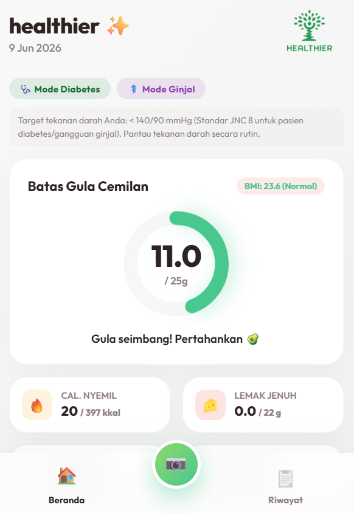

# Healthier v3.5

Aplikasi web untuk membantu pengguna mencatat asupan, membaca informasi nilai gizi pada kemasan, dan memperkirakan komposisi makanan. Aplikasi menggabungkan antarmuka JavaScript, backend FastAPI untuk OCR, serta model segmentasi makanan.

> **Catatan:** hasil OCR, estimasi porsi, dan saran dalam aplikasi bersifat informatif. Hasilnya bukan diagnosis atau pengganti saran tenaga kesehatan.

## Tampilan

<p align="center">
  
</p>

## Fitur

- Pemindaian label nutrisi menggunakan PaddleOCR dengan backend FastAPI.
- Pencarian makanan dari data nutrisi lokal `backend/nutrition.csv`.
- Estimasi segmentasi makanan menggunakan YOLO pada backend dan TensorFlow Lite di browser.
- Koreksi manual hasil deteksi sebelum digunakan dalam analisis.
- Pencatatan hidrasi, riwayat makan, dan ringkasan nutrisi di browser.
- Skor nutrisi dan aturan kesehatan yang dapat disesuaikan dengan profil pengguna.

## Teknologi

- **Frontend:** HTML, CSS, JavaScript, Chart.js, TensorFlow.js/TFLite.
- **Backend:** Python, FastAPI, PaddleOCR, PyTorch, Ultralytics.
- **Model runtime:** `models/best.pt` untuk segmentasi backend dan `models/best_float16.tflite` untuk segmentasi di browser.

## Struktur Proyek

```text
.
├── assets/
│   ├── css/                 # Gaya aplikasi
│   ├── img/                 # Logo, demo, dan gambar pendukung
│   └── js/                  # Logika frontend
├── backend/
│   ├── healthier_v3_ppocr.py
│   ├── nutrition.csv
│   └── requirements.txt
├── docs/                    # Panduan dan dokumentasi teknis
├── models/
│   ├── best.pt
│   └── best_float16.tflite
├── index.html
├── requirements.txt         # Dependensi Python proyek
└── CARA_JALANKAN.md
```

Folder `FINAL FOOD DATASET/` yang sudah ada di GitHub tetap dipertahankan. Salinan lokal dataset tersebut tidak tersedia di workspace ini. Model runtime di atas disertakan karena dibutuhkan oleh fitur segmentasi aplikasi.

## Prasyarat

- Windows 10/11 (perintah di bawah menggunakan PowerShell).
- Python 3.12 direkomendasikan; instalasi PaddlePaddle dan PyTorch harus sesuai dengan versi Python dan perangkat.
- Browser modern.
- Koneksi internet untuk pustaka frontend yang dimuat dari CDN dan unduhan model OCR pertama kali.

## Instalasi dan Menjalankan

### 1. Siapkan backend

Buka PowerShell di direktori proyek:

```powershell
py -3.12 -m venv .venv
.\.venv\Scripts\Activate.ps1
python -m pip install --upgrade pip
python -m pip install -r requirements.txt
```

Jalankan server OCR:

```powershell
python backend\healthier_v3_ppocr.py --serve --host 127.0.0.1 --port 8000
```

Biarkan terminal ini tetap berjalan. Model OCR dapat memerlukan waktu untuk diunduh dan dimuat saat pertama kali dipakai.

### 2. Jalankan frontend

Buka terminal PowerShell kedua di direktori proyek:

```powershell
python -m http.server 5500 --bind 127.0.0.1
```

Buka <http://127.0.0.1:5500> di browser. Frontend mengirim permintaan API ke `http://127.0.0.1:8000`.

### Catatan instalasi AI

`requirements.txt` memasang dependensi backend utama, termasuk PyTorch dan PaddlePaddle. Instalasi framework AI berukuran besar dan dukungan GPU bergantung pada OS, versi Python, serta CUDA. Jika instalasi GPU gagal, ikuti instruksi instalasi resmi PyTorch/PaddlePaddle untuk perangkat Anda; versi CPU dapat digunakan sebagai alternatif.

## Model yang Dibutuhkan

- `models/best.pt` digunakan untuk segmentasi makanan pada backend. Tanpa file ini, endpoint segmentasi backend tidak dapat memuat model.
- `models/best_float16.tflite` digunakan oleh segmentasi browser. Pastikan file tersedia di jalur tersebut saat menjalankan aplikasi.

Jangan pindahkan atau mengganti nama model tanpa memperbarui jalur model di kode terkait. Dataset latihan dan checkpoint eksperimen diabaikan oleh Git.

## Dokumentasi Tambahan

- [Panduan menjalankan aplikasi](CARA_JALANKAN.md)
- [Panduan OCR](docs/CARA_JALANKAN_OCR.md)
- [Panduan AI](docs/HEALTHIER_COMPLETE_AI_GUIDE.md)
- [Arsitektur sistem](docs/HEALTHIER_REAL_WORLD_ARCHITECTURE.md)
- [Analisis model Isi Piringku](docs/analisis_model_isipiringku.md)

## Batasan

- OCR dapat keliru pada foto buram, kemasan melengkung, atau teks berkontras rendah. Periksa dan koreksi hasil sebelum menggunakannya.
- Segmentasi berbasis gambar 2D tidak mengukur volume atau berat makanan secara langsung.
- Kualitas segmentasi dipengaruhi oleh jenis makanan dan cakupan data pelatihan.
- Aturan klinis dan skor nutrisi merupakan alat bantu, bukan keputusan medis.

## Kontribusi

Sebelum mengirim perubahan, pastikan path aset dan model sesuai dengan struktur proyek. Jangan unggah kredensial, file `.env`, virtual environment, dataset privat, atau output eksperimen.
