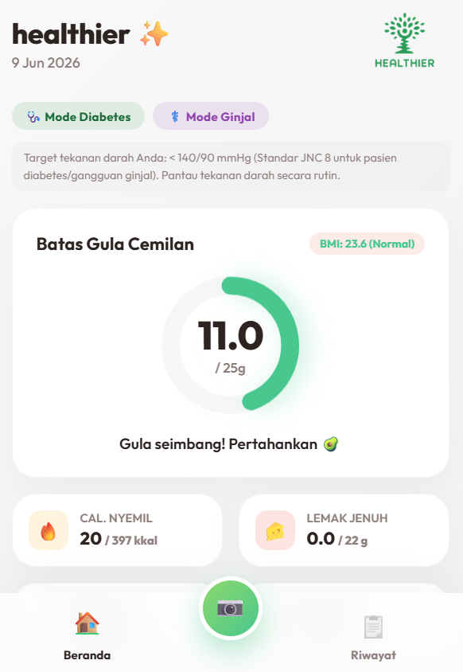

# healthier (NutriLabel v3.5) 🥗

[](https://www.python.org/)
[](https://developer.mozilla.org/en-US/docs/Web/JavaScript)
[](https://fastapi.tiangolo.com/)
[](https://github.com/PaddlePaddle/PaddleOCR)

**healthier (NutriLabel v3.5)** adalah sistem pemantauan gizi harian personal berbasis
AI untuk mengekstraksi kandungan nutrisi dari label kemasan dan mengestimasi porsi
makanan (*Isi Piringku*) dari foto.

Sistem menggabungkan Computer Vision (PaddleOCR + YOLO11-Seg), *Clinical Health Rules
Engine* (PERKENI 2024 untuk diabetes, JNC 8 + DASH untuk hipertensi), dan
*Extended Nutri-Score* (FSA/Ofcom) untuk memberikan status keamanan pangan dan saran
yang dipersonalisasi.

---

## 📸 Demo

<div align="center">
  
</div>

> Antarmuka memakai tema *glassmorphism*, progres SVG, grafik 7 hari (Chart.js), dan
> feedback kualitas foto secara real-time.

---

## ✨ Fitur Utama

| Area | Kemampuan |
| :--- | :--- |
| **OCR Label** | Preprocessing (deskew, deglare, CLAHE, watermark removal), filter semantik, rekonstruksi tabel spasial, dan normalisasi satuan. |
| **Segmentasi Piring** | YOLO11-Seg di backend + fallback TFLite/WASM di browser saat server offline. |
| **Koreksi Manual** | Editor canvas (brush per kategori, eraser, zoom/pan, minimap, undo). |
| **Logika Klinis** | Batas harian adaptif berdasarkan profil fisik dan riwayat penyakit. |
| **Nutri-Score** | Skor FSA/Ofcom diperluas dengan mikronutrien, fraksi porsi, dan mode bubuk. |
| **Evaluasi Riset** | Metrik *field-level accuracy* untuk angka gizi, bukan sekadar CER/WER. |

---

## 🗂️ Struktur Repositori

```text
Healthier/
├── backend/                 # FastAPI + pipeline OCR/YOLO
│   └── app.py
├── frontend/                # Aplikasi web statis
│   ├── index.html
│   ├── assets/              # logo, screenshot, model TFLite
│   ├── css/
│   └── js/                  # config, domain engines, UI
├── models/isipiringku_v2/   # artefak training & bobot YOLO
├── scripts/                 # evaluasi, benchmark, diagnostik
├── data/samples/            # contoh gambar & hasil OCR
├── docs/                    # arsitektur, evaluasi, panduan
├── requirements.txt
├── .env.example
└── README.md
```

> Dataset tidak disertakan. Letakkan dataset Anda di `dataset/` (sudah di-*ignore*
> oleh Git) dalam format `foto.jpg` + `foto_gt.json`.

---

## 🚀 Menjalankan Aplikasi

### 1. Prasyarat

- Python **3.10+**
- PaddlePaddle (CPU/GPU sesuai mesin)
- Browser modern (Chrome/Edge/Firefox)

### 2. Backend (FastAPI + PaddleOCR + YOLO)

```powershell
# Opsional: buat virtual environment
python -m venv .venv
.\.venv\Scripts\Activate.ps1

# Instal PaddlePaddle sesuai mesin Anda, lalu:
pip install -r requirements.txt

# Jalankan API
python -m backend.app --serve --host 127.0.0.1 --port 8000
```

Tunggu hingga muncul `Uvicorn running on http://127.0.0.1:8000`.
Request pertama bisa 15–30 detik karena model dimuat ke memori.

### 3. Frontend

```powershell
python -m http.server 5500 --directory frontend
```

Buka `http://127.0.0.1:5500`.

### 4. Mengarahkan Frontend ke API Lain

Default API: `http://127.0.0.1:8000`. Override tanpa mengubah kode:

1. Query string: `http://127.0.0.1:5500/?api=http://192.168.1.10:8000`
2. `localStorage.setItem('healthier:apiBase', 'http://192.168.1.10:8000')`
3. `window.HEALTHIER_API_BASE` sebelum `frontend/js/config.js`

---

## 🧠 Model & Bobot

Backend mencari bobot YOLO secara otomatis dengan urutan:

1. `HEALTHIER_YOLO_MODEL` (env, path absolut/relatif)
2. `models/isipiringku_v2/weights/best.pt` *(disarankan)*
3. `models/isipiringku_v2/weights/last.pt`
4. `models/isipiringku_v2/weights/best.onnx`

Fallback browser memakai `frontend/assets/models/best_float32.tflite`.

Detail performa, kurva, dan perbandingan iterasi model ada di
[docs/model-analysis.md](docs/model-analysis.md) dan
[docs/evaluation.md](docs/evaluation.md).

---

## 🧪 Evaluasi & Benchmark

```powershell
# Field-level accuracy pada dataset ber-GT
python scripts/evaluate.py -f dataset -r --gt-only

# Validasi YOLO (butuh data.yaml)
python scripts/benchmark.py val --data dataset/data.yaml

# Latensi inferensi lokal
python scripts/benchmark.py latency --images data/samples --limit 5

# Latensi endpoint API
python scripts/benchmark.py api-latency --image data/samples/label-sample.jpg

# Statistik dataset
python scripts/benchmark.py dataset-stats --folder dataset
```

> **Mengapa bukan CER/WER?** Foto kemasan nyata mengandung banyak teks non-gizi
> (slogan, tanggal kedaluwarsa, dll.) yang sengaja difilter. Karena itu metrik utama
> riset ini adalah **Field-Level Accuracy** untuk angka gizi yang relevan secara klinis.

---

## ⚕️ Dasar Klinis

- **Diabetes Melitus Tipe 2**: konsensus **PERKENI 2024**.
- **Hipertensi**: **JNC 8** dan **DASH Diet**.

Makanan diberi status `SAFE`, `WARNING`, atau `DANGER` sesuai profil pengguna.

---

## ⚠️ Batasan (Evaluasi Jujur)

| Kategori | Batasan | Mitigasi |
| :--- | :--- | :--- |
| Segmentasi | Dataset didominasi makanan Barat; makanan lokal bersaus/berkuah sering salah kelas. | Editor koreksi manual + fallback TFLite. |
| OCR | Kemasan melengkung, kontras rendah, dan fon dekoratif masih rawan *false negative*. | Preprocessing + form koreksi nilai. |
| Porsi | Estimasi 2D belum mengukur volume/ketebalan. | Tampilkan proporsi sebagai estimasi. |
| Klien | Model TFLite ±39 MB membebani perangkat RAM kecil. | Backend sebagai mode utama. |

---

## 📚 Dokumentasi

- [Arsitektur sistem](docs/architecture.md)
- [Panduan teknis lengkap](docs/ai-guide.md)
- [Data & metrik evaluasi](docs/evaluation.md)
- [Analisis model Isi Piringku](docs/model-analysis.md)
- [Menjalankan OCR](docs/ocr-setup.md)

---

*Dikembangkan untuk keperluan penelitian AI dan kesehatan personal terintegrasi.*
